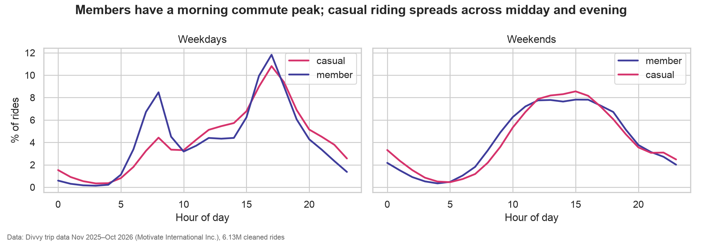

# Cyclistic bike-share: how do casual riders and annual members ride differently?

Google Data Analytics Capstone, Track A. Analysis in **DuckDB (SQL) + Python (pandas, seaborn)** on **6.13 million rides** (Nov 2025 – Oct 2026, Divvy public trip data).



## Business task
Cyclistic's director of marketing wants to grow annual memberships. This analysis answers the first question of the new marketing program: **how do annual members and casual riders use Cyclistic bikes differently?** The findings feed a campaign to convert casual riders into members.

**Stakeholders:** Lily Moreno (director of marketing), the marketing analytics team, the executive team.

## Elevator pitch
> I analysed a full year of Chicago bike-share data, about 6 million rides, to see how casual riders differ from members. Members ride short, regular trips with a clear commute pattern; casual riders ride longer, mostly on summer weekends, and cluster at lakefront and museum stations. A quarter of casual rides already look like commutes. I recommend a summer-weekend membership, a lakefront campaign in peak season, and a targeted offer for commuter-like casual riders. I did the cleaning and analysis in SQL (DuckDB) and Python.

## Key findings
| # | Finding | Evidence |
| ---: | --- | --- |
| 1 | Casual riders take **1 in 3 rides**, and their share is seasonal | 35.3% of rides; 17.9% in Jan 2026 → 40.8% in Jul 2026 |
| 2 | Casual rides are **longer** | median 11.1 vs 8.7 min (+28%); 90th percentile 35.4 vs 23.4 min; 13.2% vs 5.4% of rides over 30 min |
| 3 | Casual riders ride on **weekends** | 37.6% of casual rides on Sat/Sun (Saturday alone 21.5%) vs 23.7% for members |
| 4 | Members **commute** | both peak at 17:00 on weekdays, but 07:00–08:59 holds 15.2% of members' weekday rides vs 7.7% for casual riders; 38.5% vs 25.1% of rides in weekday commute windows |
| 5 | Casual demand is **concentrated in summer** | peak month / quietest month = 14.5× for casual vs 4.7× for members; 69.3% of casual rides in May–Sep vs 58.5% |
| 6 | The **lakefront is casual territory** | casual riders make 76–82% of rides at Navy Pier, Shedd Aquarium, Field Museum, DuSable Lake Shore Dr & Monroe St; round trips 7.4% vs 2.2% (rides with known stations) |
| 7 | A **commuter-like casual segment** exists | 25.1% of casual rides (~540k) happen on weekdays at commute hours |

Charts: [`figures/`](figures/) · full analysis: [`notebooks/cyclistic_analysis.ipynb`](notebooks/cyclistic_analysis.ipynb) · interactive dashboard: [Tableau Public](https://public.tableau.com/app/profile/ha.nguyen.thi.thu8875/viz/shared/D86ZF2XQ6)

## Recommendations
1. **Summer weekend membership offer** (findings 1, 3, 5). A seasonal or "weekend member" plan promoted May–September, upgradable to a full annual membership.
2. **Lakefront campaign in peak season** (finding 6). Geo-targeted ads, in-app messages and dock QR codes at Navy Pier, Shedd Aquarium, Field Museum, Millennium Park and DuSable Lake Shore Dr, weekends 12:00–18:00, showing what a member would have saved on a long ride.
3. **Convert commuter-like casual riders** (findings 2, 4, 7). A "you already ride like a member" message with a savings calculator for casual riders who ride on weekdays at commute hours.

## Limitations and next steps
- Rides, not people: there is no rider ID, so we cannot count individuals or measure conversion. Next: anonymised account data.
- No prices or revenue: savings messages need current pricing from finance.
- 19.8% of rides have no start station name (mostly e-bikes); station results use rides with known stations only.
- Next analyses: weather and event effects, e-bike pricing sensitivity, a survey of casual riders on why they have not joined.

## Process
| Phase | Where |
| --- | --- |
| Ask | notebook §1 |
| Prepare | [docs/data_sources.md](docs/data_sources.md) (sources, license, ROCCC, quality checks, limitations), `scripts/download_data.py` |
| Process | notebook §3, [docs/changelog.md](docs/changelog.md) (6,294,451 → 6,130,112 rows) |
| Analyze | notebook §4 |
| Share | notebook §5, `figures/`, `slides/cyclistic_case_study.pptx` |
| Act | notebook §6, this README |

## Run it
```bash
python3 -m venv .venv && source .venv/bin/activate
pip install -r requirements.txt
python scripts/download_data.py          # 2025-11 → 2026-10, ~238 MB zip, not committed
jupyter lab notebooks/cyclistic_analysis.ipynb
```

Data: Divvy trip data, Motivate International Inc., used under the [Divvy Data License Agreement](https://divvybikes.com/data-license-agreement).
